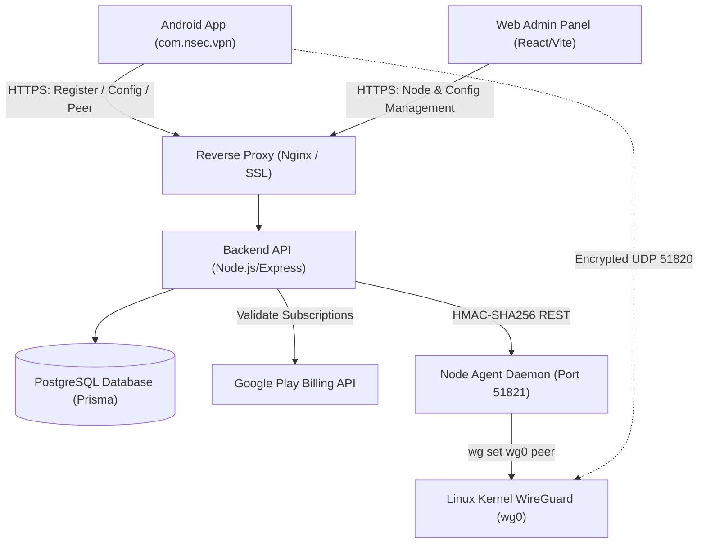

> Repair candidate: see [E2E repair report](docs/E2E-REPAIR-REPORT.md). Production readiness and real-device verification remain pending.

Disconnect confirms the local tunnel is DOWN before returning Home; backend peer cleanup runs independently with a bounded timeout and retained server leases on uncertain removal.

Advertising uses Google UMP 4.0.0: requests wait for UMP authorization and SDK initialization. Configure Privacy & Messaging in the existing AdMob account; Settings exposes required privacy choices and update retries. VPN access never depends on ad consent.

Interrupted connections restore from a Keystore-encrypted node intent using fresh authenticated peer negotiation. Manual disconnect clears that intent. Android always-on/lockdown remains optional in Settings and may block excluded ad/API traffic; test it on the actual phone. Split-tunnel changes now reconnect to apply immediately.

Forced update uses the existing numeric Remote Config fields on both client and peer provisioning. New APKs send `X-App-Version-Code`; enabling forced updates rejects older/missing codes with HTTP 426 `APP_UPDATE_REQUIRED`. This self-reported version is a compatibility gate, not device attestation. Publish the compatible APK before enabling it.

Public agent origins require HTTPS. HTTP is accepted only for literal private/loopback management origins carried by your encrypted management channel; the existing `172.18.0.1:51823` SSH forward is compatible. New installations bind the raw agent to loopback. Existing public HTTP records must migrate before deploying this policy.

Owner-selected retention is 90 days (`RETENTION_DAYS`), cleaned hourly. Expired tokens, unclaimed expired tickets, completed/rejected requests and audit records age out. Inactive free identities are deleted only without recovery credentials, blocked status, purchase/promo/reward history or any peer reservation; these exceptions preserve entitlements and abuse protection. No client IP or traffic data is collected by this cleanup.

The admin console uses the routed `Control*` pages only. Eight obsolete, unreachable screens/sidebar/dialog components were removed after checking the entry-point import graph and test references.

Subscription reconciliation stores AES-GCM encrypted receipts using a separate `PLAY_TOKEN_ENCRYPTION_KEY`, checks Google Play at most every five minutes per tracked receipt, and supports authenticated Pub/Sub pushes at `/api/v1/billing/rtdn`. Configure the Google Play credential, exact push audience and push service-account email. Refunds remove only the paid contribution; promo/reward/admin grants are protected. Older unattributed VIP is preserved conservatively until its existing expiry and needs operator review for stronger revocation. Apply `scripts/migrate-audit-followup.sql` before this backend release and retain the receipt encryption key across deployments.

The v2 deep-audit package preserves main's build-directory ignore update. Its publisher creates an isolated repair checkout; use the printed comparison link to create the pull request when GitHub CLI is unavailable. See [the repair checkpoint](docs/audit/REPAIR-CHECKPOINT.md) before merging or deploying.

# 🛡️ Nsec VPN — High-Speed WireGuard® Android Client & Management Suite

[](https://developer.android.com)
[](https://www.wireguard.com)
[](https://developer.android.com/jetpack/compose)
[](https://docker.com)
[](https://nsecvpn.com/privacy)

**Nsec VPN** (`com.nsec.vpn`) is a WireGuard® VPN application designed for Android devices, paired with a web management portal and scalable gateway orchestration backend.

Official Website: **[nsecvpn.com](https://nsecvpn.com)**

---

## 📑 Table of Contents
1. [Key Features & Capabilities](#-key-features--capabilities)
2. [Project Architecture](#-project-architecture)
3. [Quick Start Guides](#-quick-start-guides)
4. [Documentation Library](#-documentation-library)
5. [Google Play Store Release & Policy](#-google-play-store-release--policy)
6. [License & Privacy Guarantee](#-license--privacy-guarantee)

---

## 🚀 Key Features & Capabilities

### 📱 Android Client (`/app`)
- **Modern Pro UI**: High-contrast Material 3 Light/Dark theme with responsive cards, micro-animations, and live stats.
- **WireGuard® Protocol Engine**: Userspace Go backend (`wireguard-android`) using ChaCha20-Poly1305 encryption and Curve25519 key exchanges.
- **Android compatibility**: Release validation must cover supported Android versions, foreground-service restrictions and actual native-library page alignment. Build flags alone do not establish compliance.
- **Smart Native Ads Monetization**: Google Native Ads integration (`SmartNativeAd`) with compact, medium, and large layouts, shimmer states, lifecycle caching, and robust null-safety across Home, Server List, and Speed Test screens.
- **AdMob Traffic Split Tunneling Bypass**: Automatic package exclusion in `WireGuardTunnelManager` and `NsecVpnService` routing Google Mobile Ads SDK calls outside the VPN tunnel to prevent ad request timeouts or policy flags.
- **Smart Connect**: Ranks eligible nodes by capacity and measured endpoint latency; successful connection requires a real WireGuard handshake. Latency checks are ICMP measurements and can be unavailable when a provider blocks probes.
- **Custom Encrypted DNS**: One-tap selection between Cloudflare (`1.1.1.1`), Google (`8.8.8.8`), AdGuard (`94.140.14.14`), and Quad9 (`9.9.9.9`).
- **App Split Tunneling**: Exclude banking, local entertainment, or ad SDK apps from the VPN tunnel.
- **Kill Switch Deep-Link**: Native deep-linking into Android system *Always-On VPN* settings.
- **Speedometer & Diagnostics**: Real-time throughput graph, MTU clamping (1420), and DNS leak test verification.
- **Anonymous Authentication**: Random installation IDs with device-held registration proof; Android Keystore protects local encryption. No email addresses, phone numbers, or passwords.
- **Quick Settings Tile**: Toggle VPN directly from Android notification shade.

### 🖥️ Web Admin Panel (`/admin-panel`)
- **Node Management**: Add, modify, or disable WireGuard endpoints, public keys, country flags, and tiers (**FREE** vs. **VIP**).
- **Live Health Monitoring**: Real-time heartbeat queries to edge nodes reporting active peer count and CPU load.
- **Remote Configuration**: Toggle AdMob banners, interstitials, and rewarded ads remotely without app updates.
- **Network Emergency Alerts**: Broadcast announcements directly to the mobile app home screen.
- **Role-Based Access Control**: Server-enforced Super Admin vs Admin permissions with immutable audit trail.

### ⚙️ Gateway Agent & Node Daemon (`/agent`)
- **Zero Shell Injection**: Parameterized `execFile` calls executing kernel `wg set` operations.
- **Reboot Persistence**: `SaveConfig = true` and `wg-quick save` ensure dynamic peer leases survive reboots.
- **Replay-Protected Control**: HMAC-SHA256 signatures with 60-second validity window and deduplication cache.

---

## 🏗️ Project Architecture



---

## ⚡ Quick Start Guides

### 1. Backend API (`/backend`)
```bash
cd backend
npm install
npx prisma generate
npm test
npm run build
npm start
```

### 2. Web Admin Panel (`/admin-panel`)
```bash
cd admin-panel
npm install
npm run build
npm run preview
```

### 3. WireGuard Node Agent (`/agent`)
```bash
cd agent
npm install
npm run build
npm start
```

### 4. 1-Click WireGuard Node Installer (Ubuntu 22.04 / 24.04)
```bash
sudo ./deployment/install-wireguard-node.sh
```

### 5. Android Client (`/app`)
Open the project in Android Studio, sync Gradle, and run `:app` on your Android device or emulator.

---

## 📚 Documentation Library

- [Architecture & Design Details](docs/ARCHITECTURE.md)
- [REST API Specification](docs/API.md)
- [Production Deployment Guide](docs/DEPLOYMENT.md)
- [Administrator Console Guide](docs/ADMIN_GUIDE.md)
- [Google Play Store Release Checklist](docs/PLAY_STORE_CHECKLIST.md)
- [Zero-Logs Privacy Policy Template](docs/PRIVACY_POLICY_TEMPLATE.md)
- [Terms of Service Template](docs/TERMS_TEMPLATE.md)
- [Security & Threat Model](docs/SECURITY.md)
- [Automated & Manual Testing Plan](docs/TESTING.md)
- [Changelog](CHANGELOG.md)
- [Contributing](CONTRIBUTING.md)

---

## 🔒 License & Privacy Guarantee

The code avoids traffic, browsing and DNS-query persistence. Operational device/authentication/entitlement/peer records are retained; hosting and third-party logging settings require operator verification. WireGuard® is a registered trademark of Jason A. Donenfeld.
Distributed under the Apache 2.0 License.
update

## Admin experience and configuration update

Read [the immutable source audit](docs/EXPERIENCE-AUDIT.md) and [phase 1 setup, migration, API changes and acceptance checklist](docs/EXPERIENCE-PHASE1.md). The redesigned console uses real backend data, day-based promotions, authenticated requests/device lookup and a global ads switch. Retrievable codes require a privately configured `PROMO_CODE_ENCRYPTION_KEY`; existing hashes and exact minute entitlements are retained. Run the additive migration and exact-release schema approval before deploying the new images. Android items and the separate speed-test helper are tracked as subsequent work, not claimed complete by this release.

Remote settings are refreshed by the Android activity every 30 seconds and cached only after validation. The new DTO fields are optional for older backend compatibility. Backend maintenance rejects new peer creation; app connection controls also require verified settings. See phase 1 verification steps before installing an updated APK.

## Android experience phase 2

Navigation, Settings support/server requests/device ID, persisted DNS reconnect, verified server cache and truthful troubleshooting are covered in [EXPERIENCE-PHASE2.md](docs/EXPERIENCE-PHASE2.md). Speed tests now stay in-app and require the separately installed, matching-signature `speedtest-helper` APK; main app ad traffic remains excluded. Use `scripts/install-android-debug.ps1` in Android Studio Terminal to build/install both APKs. Apply the phase-1 backend migration first, and wait for CI and phone verification before publishing.

## App appearance update

The charcoal dark theme and redesigned Server Request sheet are documented in [APP-RESKIN.md](docs/APP-RESKIN.md), including the admin steps for changing the app support email. No new dependency or database migration is needed.

## Android CI backup-policy repair

See [Actions CI repair](docs/ACTIONS-CI-REPAIR.md) for the failed run evidence and fix. Run `python3 scripts/check-android-backups.py` before Android builds; both Android modules must explicitly exclude cloud/device backup data. The CI deployment gate remains enabled.

## Live load and rewarded VIP

See [live load/rewarded VIP](docs/LIVE-LOAD-REWARDED-VIP.md). Configure Rewarded pass minutes = 45 in the VPN admin panel to show/grant the requested offer. Home displays the real connected node’s current measured peer capacity while foreground polling runs; no migration is needed.

The VPN-bound speed test still requires the matching-signature companion application. See [two-app Google Play release](docs/PLAY-STORE-TWO-APPS.md) before publishing either bundle.

### Compact Home layout

The Home reward offer uses a compact row. Tap **Watch ad** to request the configured rewarded pass, or tap the card for full VIP details and paid plans. Smaller spacing and connect control leave more room for the server selector and existing native ad. Scrolling remains available for small screens, large fonts, announcements and variable ad sizes. VIP/ad-free users still follow the existing ad suppression rules.

### Location pools and compact speed tests

The Android catalog displays one country/city location backed by individual nodes. New clients ask the backend for an eligible node ranked by reserved capacity and measured latency, with transaction-protected capacity fallback and explicit all-full errors. Speed-test history is removed, the gauge/layout is compact, and cold startup includes theme-aware Europe branding. Deploy the updated backend before installing the APK. No database migration or dependency is added. See [APP-POLISH-LOCATION-POOLS.md](docs/APP-POLISH-LOCATION-POOLS.md) for audit evidence, API compatibility and device checks.

### VIP recovery after clearing storage

Use Settings → Device VIP Recovery to configure a private PIN before clearing app data. Save the original Device ID and PIN; restore with both to recover the same backend VIP record and expiry. Device ID alone cannot authorize recovery. The required additive SQL migration and reviewed-schema deployment steps are in [DEVICE-VIP-RECOVERY-NATIVE-SPLASH.md](docs/DEVICE-VIP-RECOVERY-NATIVE-SPLASH.md). Europe branding now appears on the original native launch window; the extra splash page is removed. The extra in-app disclosure was removed in a later update; Android VPN permission remains. Review current Play VPN and advertising disclosure requirements before publishing.

## Deep audit and repair

The read-only baseline review, severity-ranked findings and verification limits are in [Deep audit](docs/audit/DEEP-AUDIT-2026-10-13.md). Findings are not a guarantee of production readiness.

Rewarded VIP is granted only by AdMob's signed server-side callback. Configure every live rewarded unit's SSV URL to `https://api.nsecvpn.com/api/v1/billing/rewarded/ssv`. The app passes its installation ID and one-use ticket through SSV options. Local ad-free time starts after the SDK reward callback; VIP servers unlock after verification, with bounded in-app polling and a persisted retry. A pending claim returns HTTP 202 (`REWARD_VERIFICATION_PENDING`), never a new entitlement. Existing clients retain their pending ticket but need the updated APK for prompt polling.

The peer-reservation repair needs the additive `scripts/migrate-peer-reservations.sql` migration before deploying its backend image. A lease renewal keeps one device/node record and its assigned IP, and issues a fresh `peerId` so stale disconnects cannot revoke the replacement. Failed registrations return no configuration; reservations are released after acknowledged cleanup, otherwise retained with both tracked keys and reconciled after two minutes. New errors are `PEER_CLEANUP_PENDING` (503) and `PEER_RESERVATION_CHANGED` (409). Run the dedicated schema approval helper only for an exact, CI-passing release after the migration; deployment remains separate.

Expired entitlement updates compare the observed tier, expiry and authentication epoch; concurrent promo, reward, recovery and purchase grants are preserved. Verified purchases retain the longest current grant. Profile database failures return `PROFILE_UNAVAILABLE` (503); missing devices return 404 instead of a successful null profile.


Android token renewal, registration and recovery now share a mutex. Parallel unauthorized requests reuse the newly issued access token instead of rotating the same refresh token twice. Cancellation and transient authentication failures no longer silently trigger registration.

For reverse-proxy deployments set `TRUSTED_PROXY_CIDRS` to the actual trusted proxy IP ranges (comma-separated explicit CIDRs). Direct deployments leave it empty. Never trust all addresses or use a fixed hop count. Verify CloudPanel/Cloudflare's forwarding configuration before choosing ranges; the backend's Docker bridge gateway alone may not represent the full proxy chain. User rate-limit identifiers remain salted HMACs in memory; no IP access logs are added. Health/readiness probes use a separate route from the user quota. Malformed agent bodies now fail with HTTP 400 before any command executes.

Android token renewal, registration and recovery now share a mutex. Parallel unauthorized requests reuse the newly issued access token instead of rotating the same refresh token twice. Cancellation and transient authentication failures no longer silently trigger registration.


Node create/update responses preserve a successful database write even when the subsequent health probe fails: inspect optional `healthCheckError`, then use Test node. Edited nodes are excluded until a fresh health check validates their configuration. Admin device details and request filters accept the same safe installation-ID format as registration, including legacy non-UUID IDs. CSV exports neutralize control/whitespace-prefixed spreadsheet formulas.

Promo, usage and audit tables recover from an out-of-range page after deletion/filter changes. Modal keyboard focus remains in the dialog during saves and returns to the opener only on close. Regression checklist: delete the last campaign on page 2; change usage search; save with keyboard while the form is busy; verify focus and pagination.

Native ads refill their bounded pool when released and react to load events instead of polling every ten seconds. Video ads use a MediaView template and hide when constrained space cannot safely contain it. Template changes recreate the native view. Validate text/video formats, large fonts, rotation and repeated refreshes with live AdMob test devices before publishing.

Ad refresh timing uses a monotonic clock. Local reward expiry checks wake at most once a minute while still scheduling the exact remaining expiry, reducing idle wakeups without changing grant duration.

Catalog refreshes coalesce for five seconds and manual refresh bypasses that window. Latency checks stay asynchronous and refresh at most once a minute. Catalog mapping now indexes previous nodes once (linear work rather than repeated list searches); config/reward polling runs only while the activity is STARTED. Cache-first display remains unchanged. Phone startup/perceived-load and battery measurements still require device profiling.

A delayed profile response cannot overwrite a newer promo/reward response in the app. The backend remains the authority for actual premium access.

The client accepts dual-stack hostnames only through their verified public IPv4, baselines throughput counters before displaying rates, and rechecks connection eligibility after Android permission returns. Split-exclusion edits explicitly require reconnect; automatic live reconfiguration is deferred to device-tested lifecycle work. Error tiles reopen the app, tile scopes are cancelled on destruction, and the unused boot permission is removed.

Tunnel activation, DNS reconnect and teardown now run exclusively, with cancellation joined before the next operation. Peer/notification state is cleared only after the backend confirms DOWN; shutdown failures remain visible and retain the tracked tunnel. This improves lifecycle consistency but is not an OS kill switch or process-death restoration. Speed helper sessions disconnect at their deadline and ignore late network-loss callbacks; verify blocked upload/network switching on a phone.

The current [repair checkpoint](docs/audit/REPAIR-CHECKPOINT.md) records exact checks, migration commands, API compatibility, outstanding security decisions and the publishing no-go. Read it before merging or updating containers.

The installer now upgrades runtimes older than Node 22, matching CI. Existing Node 20 agents need a maintenance upgrade; the script is not run automatically by this repair. See the checkpoint for the exact node commands.

When connector writes are unavailable, the downloadable bundle publisher (`scripts/publish-deep-audit.py`, copied beside its package manifest/bundle) imports the reviewed commits into a separate checkout. `--publish` pushes only the repair branch; it opens a draft PR with authenticated GitHub CLI when available, otherwise prints the comparison link. It does not stage local edits, modify main, migrate data or deploy services.

Restoration matches saved location names without case sensitivity; ad-flow tests explicitly authorize consent instead of assuming it.

Settings now offers Restore Google Play Purchases, which only queries owned subscriptions and re-verifies them on the backend; it never opens a purchase flow. After clearing data, recover the original device identity first for already-bound purchases. Promo days extend non-purchase VIP separately from paid coverage, as selected by the owner.

Audit follow-up: see [the rollout and test guide](docs/audit/AUDIT-FOLLOWUP.md) for disconnect latency, consent, restoration, billing reconciliation, retention and the additive migration. `scripts/publish-audit-followup.py` imports the reviewed transport bundle into a separate Git checkout without changing existing Android Studio edits.

PR #17: billing setup indentation corrected; behaviour unchanged.

### Advertising UI update
The owner-requested UMP consent form and ad privacy settings rows are removed. Ads wait for asynchronous SDK readiness and request non-personalized ads (`npa=1`); existing IDs, reward verification and admin toggles remain unchanged. This removal does not establish consent or satisfy every regional/provider privacy requirement: review AdMob publication requirements before release.

### Disconnect screen transition
Home remains composed and measured while connection details are open, but is not placed/drawn and its ad slot and pulse are disabled while hidden. Disconnect returns to that retained Home immediately with an honest Disconnecting state; reconnect stays disabled until confirmed local DOWN. State colours no longer animate over 500ms. Native SDK load work starts after the first navigation frame. No tunnel, API or schema changes are required.

See [Disconnect UI update](docs/audit/DISCONNECT-UI-FIX.md) for video findings, consent removal, regression tests and installation. `scripts/publish-disconnect-ui.py` imports its reviewed bundle into a separate checkout and opens or links a PR; no migration is required.

- Align the EU flag with Made in Europe on the native splash; preserve logo size and theme colours.

Reward-offer startup: validated real settings are restored off Main before the first Home frame, with a native splash wait capped at 250ms and never held for HTTP. Offer text uses authoritative config independently of SDK readiness; SDK requests still wait for initialization. A first install without verified cache shows a compact static skeleton instead of a temporary marketing/loading card; live errors are explicit. Existing local ad-free reward state is visible before SDK initialization.
The startup regression uses an isolated test boot count to exercise the real monotonic reward-expiry policy; production expiry rules are unchanged.

See [Reward startup fix](docs/audit/REWARD-STARTUP-FIX.md) for screenshot findings, validated cache bootstrap, SDK-independent offer text, preserved splash alignment and installation. `scripts/publish-reward-startup.py` prepares an isolated checkout; no migration is required.

- Refresh reward-startup transport against merged splash PR #19; use a separate final checkout and v2 updater to avoid stale files.


## UI audit baseline
See [UI audit](docs/audit/UI-AUDIT.md) for the source-only findings and explicit device measurement limits. UI-only repair work uses `fix/ui-smoothness-audit`; no database or VPN changes are planned.


### UI state and rendering
Live tunnel statistics are isolated to connection details; tab state is saved, safe insets are consumed once, background animations/native-ad refreshes stop, and connect taps have visible feedback. VPN operations and ad IDs are unchanged.


### Responsive UI and honest app lists
Server controls and skeletons now share one lazy list with saved search/filter state, empty results and 48dp filters. Location badges and speed metrics wrap; recovery forms accommodate the keyboard. Split tunneling displays only real installed apps, with loading/retry/empty states. Server requests have bounded UI waiting.


### DNS presentation and splash branding
The DNS picker uses selectable provider cards, active resolver status and inline custom validation. Saves report automatic application without a manual reconnect instruction. Existing tunnel rebuilding is unchanged. The EU flag follows the splash text at the same size and baseline. No new dependencies, environment variables or migrations.


### Status accessibility
Small success/warning labels use theme-aware foreground colors while preserving brand fills. Device visual checks at large font sizes remain required.


### UI regression and profiling checks
New Compose regressions cover scoped live stats, saved server search, DNS selection/error/status and honest app choices. A device test covers connect/disconnect presentation. The privacy-limited `scripts/profile-ui.py` records actual frame deadlines/startup/memory; parser tests run in CI. See [UI verification](docs/audit/UI-VERIFY.md) for low-end, large-font and day/night checks. Android checks remain pending where no SDK/device is available.


### UI repair publication
The UI-only repair can be imported with `scripts/publish-ui-audit.py` and its accompanying reviewed Git bundle. Publishing uses a new branch, preserves the original checkout and requires unchanged audited main. See [PR summary](docs/audit/UI-AUDIT-PR.md); no deployment is performed.


### Server and speed-test alignment
Server names and badges share a baseline and wrap without leading spacer items. Speed metrics use balanced two-by-two phone rows, four columns on wide screens, and one column for large text. The speed-test subtitle is centered when it wraps. No VPN or measurement logic changed.


### Settings and recovery alignment
App Version is inside Developer / Debug and remains visible in release; debug diagnostics remain gated. Account recovery has its own section. Settings and the Device VIP Recovery sheet share a wrapping Device ID card with Copy/Copied feedback. Only the installation ID is copied. Home text actions are vertically centered in their touch targets.


### In-place theme switching
MainActivity handles `uiMode` configuration changes so Compose updates the palette without activity recreation. Existing native splash preference synchronization remains intact. System-bar appearance updates only when theme/view changes, and native ad XML views refresh for new night-mode resources. Routing, data models, consent and ad IDs are unchanged; confirm real transition timing on the phone.


### VIP sheet and verified reward feedback
The VIP options sheet is compact with a close action and balanced plan rows. Pending VIP now comes from an actual reward ticket, not ad-free time. Claims check verified grants more promptly, serialize requests, bound waiting, retry while foregrounded without the prior five-minute throttle, and reject expired/free responses rather than showing false activation. Both benefits start from a confirmed VIP grant. This requested reward follow-up changes only Android reward coordination; backend signature verification remains mandatory and unchanged. Live SSV delivery/configuration still requires verification; debug test-unit rewards are not production VIP proof.


### Server refresh feedback
The server refresh icon rotates during the actual catalog refresh, disables duplicate taps and announces its loading state. Rotation stops in the background and when the request completes. Lazy latency probing retains its existing behavior. Reward request timeouts retain pending tickets and no longer cancel the foreground retry loop.


### Alignment and reward regressions
Tests cover inline server badges, balanced metrics, large fonts, recovery ID clipboard content, Settings ordering, duplicate refresh taps, verified/pending/expired reward responses and the retry-throttle regression. A manifest check keeps in-place theme handling limited to uiMode. Android runtime checks require CI/Android Studio.


### Alignment follow-up publication
See [alignment and VIP follow-up](docs/audit/UI-ALIGNMENT-UPDATE.md) for evidence, scope, AdMob SSV setup and phone checks. The accompanying Git bundle and `scripts/publish-alignment-vip.py` import a reviewed branch into a separate checkout. No backend deployment or migration is performed.

## VIP Access And Home Banner Update

VIP-only server selection and connection now offer Purchase VIP Plan / Watch An Ad before creating a tunnel. Settings keeps Device ID last. Server filters occupy equal widths, and speed-test Ping, Jitter and measured Peak occupy a single row. Home announcements appear as centered dismissible banners, preserve dismissal for unchanged content and refresh every five seconds while Home is visible. See [the rollout notes](docs/audit/VIP-HOME-UPDATE.md). No backend API, schema or migration changes.

UI follow-up: centered live Home announcement with X; full-width equal server filters; single-row Ping/Jitter/Peak speed metrics; Device ID remains the last Settings item. Regression coverage includes large fonts, dismissal/content updates and premium selection.

Publication: `scripts/publish-vip-home.py` imports reviewed commits into an isolated `Nsec-VPN-vip-home-repair` checkout and pushes only the repair branch with an exact-main guard. Source project edits, main, deployment and credentials are preserved.

CI correction: allow one physical pixel of Compose rounding in equal-width metric tests and explicitly opt into the coroutine virtual-time API. Runtime UI remains unchanged.

## Popup And Live Server Status Polish

VIP access prompts now use a compact card with an X, a prominent rewarded-ad action, a separate purchase action and the actual reward availability reason. Centered Home announcements use the same surface, spacing and close treatment in both themes. Device VIP Recovery adds a pinned X, preserving the existing in-flight-operation dismissal guard. Servers checks live metadata every five seconds while visible, without toggling foreground loaders. No backend/API/schema changes or migrations. See [rollout notes](docs/audit/POPUPS-LIVE-SERVERS.md).

Publication: `scripts/publish-popups-live.py` imports this review into an isolated `Nsec-VPN-popup-live-repair` checkout, preserving existing edits and publishing only its new branch after checking the main revision.
