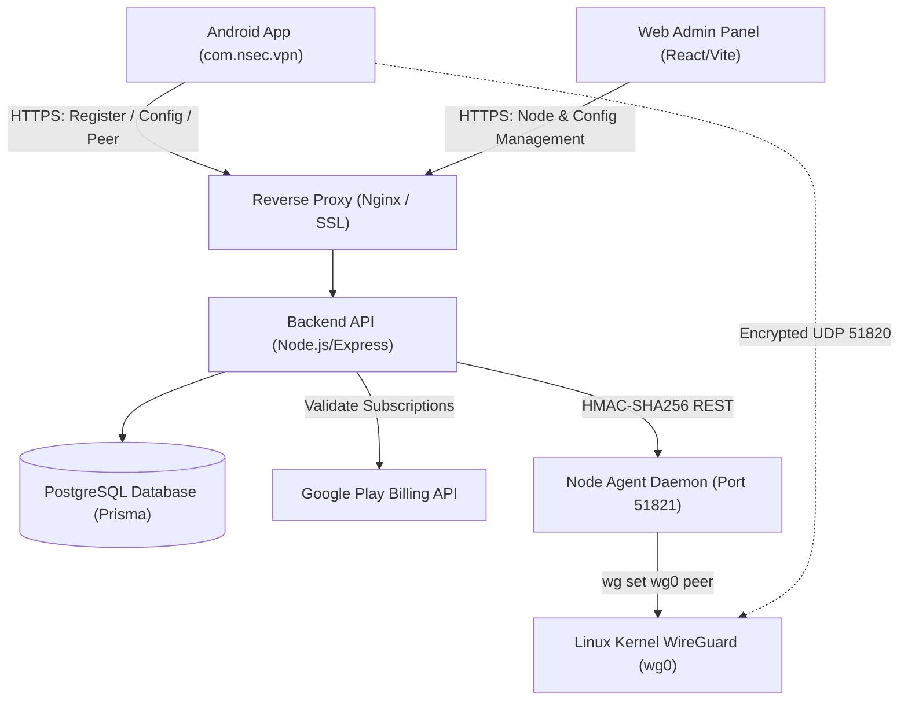

> Repair candidate: see [E2E repair report](docs/E2E-REPAIR-REPORT.md). Production readiness and real-device verification remain pending.

# 🛡️ Nsec VPN — High-Speed WireGuard® Android Client & Management Suite

[](https://developer.android.com)
[](https://www.wireguard.com)
[](https://developer.android.com/jetpack/compose)
[](https://docker.com)
[](https://nsecvpn.com/privacy)

**Nsec VPN** (`com.nsec.vpn`) is a modern, production-grade, zero-logs WireGuard® VPN application designed for Android devices, paired with a web management portal and scalable gateway orchestration backend.

Official Website: **[nsecvpn.com](https://nsecvpn.com)**

---

## 📑 Table of Contents
1. [Key Features & Capabilities](#-key-features--capabilities)
2. [Project Architecture](#-project-architecture)
3. [Quick Start Guides](#-quick-start-guides)
4. [Documentation Library](#-documentation-library)
5. [Google Play Store Release & Policy](#-google-play-store-release--policy)
6. [License & Privacy Guarantee](#-license--privacy-guarantee)

---

## 🚀 Key Features & Capabilities

### 📱 Android Client (`/app`)
- **Modern Pro UI**: High-contrast Material 3 Light/Dark theme with responsive cards, micro-animations, and live stats.
- **WireGuard® Protocol Engine**: Userspace Go backend (`wireguard-android`) using ChaCha20-Poly1305 encryption and Curve25519 key exchanges.
- **Android 14-16 & 16 KB Page Size Compliant**: Fully compliant with Android 14, 15, and 16 (`systemExempted` foreground service type) and 16 KB memory page size alignment for JNI binaries (`useLegacyPackaging = true`).
- **Smart Native Ads Monetization**: Google Native Ads integration (`SmartNativeAd`) with compact, medium, and large layouts, shimmer states, lifecycle caching, and robust null-safety across Home, Server List, and Speed Test screens.
- **AdMob Traffic Split Tunneling Bypass**: Automatic package and domain exclusion rules in `WireGuardTunnelManager` and `NsecVpnService` routing Google Mobile Ads SDK calls outside the VPN tunnel to prevent ad request timeouts or policy flags.
- **Smart Connect**: Automatically checks global node latencies via UDP socket handshakes and connects to the optimal gateway.
- **Custom Encrypted DNS**: One-tap selection between Cloudflare (`1.1.1.1`), Google (`8.8.8.8`), AdGuard (`94.140.14.14`), and Quad9 (`9.9.9.9`).
- **App Split Tunneling**: Exclude banking, local entertainment, or ad SDK apps from the VPN tunnel.
- **Kill Switch Deep-Link**: Native deep-linking into Android system *Always-On VPN* settings.
- **Speedometer & Diagnostics**: Real-time throughput graph, MTU clamping (1420), and DNS leak test verification.
- **Anonymous Authentication**: Random installation IDs with device-held registration proof; Android Keystore protects local encryption. No email addresses, phone numbers, or passwords.
- **Quick Settings Tile**: Toggle VPN directly from Android notification shade.

### 🖥️ Web Admin Panel (`/admin-panel`)
- **Node Management**: Add, modify, or disable WireGuard endpoints, public keys, country flags, and tiers (**FREE** vs. **VIP**).
- **Live Health Monitoring**: Real-time heartbeat queries to edge nodes reporting active peer count and CPU load.
- **Remote Configuration**: Toggle AdMob banners, interstitials, and rewarded ads remotely without app updates.
- **Network Emergency Alerts**: Broadcast announcements directly to the mobile app home screen.
- **Role-Based Access Control**: Server-enforced Super Admin vs Admin permissions with immutable audit trail.

### ⚙️ Gateway Agent & Node Daemon (`/agent`)
- **Zero Shell Injection**: Parameterized `execFile` calls executing kernel `wg set` operations.
- **Reboot Persistence**: `SaveConfig = true` and `wg-quick save` ensure dynamic peer leases survive reboots.
- **Replay-Protected Control**: HMAC-SHA256 signatures with 60-second validity window and deduplication cache.

---

## 🏗️ Project Architecture



---

## ⚡ Quick Start Guides

### 1. Backend API (`/backend`)
```bash
cd backend
npm install
npx prisma generate
npm test
npm run build
npm start
```

### 2. Web Admin Panel (`/admin-panel`)
```bash
cd admin-panel
npm install
npm run build
npm run preview
```

### 3. WireGuard Node Agent (`/agent`)
```bash
cd agent
npm install
npm run build
npm start
```

### 4. 1-Click WireGuard Node Installer (Ubuntu 22.04 / 24.04)
```bash
sudo ./deployment/install-wireguard-node.sh
```

### 5. Android Client (`/app`)
Open the project in Android Studio, sync Gradle, and run `:app` on your Android device or emulator.

---

## 📚 Documentation Library

- [Architecture & Design Details](docs/ARCHITECTURE.md)
- [REST API Specification](docs/API.md)
- [Production Deployment Guide](docs/DEPLOYMENT.md)
- [Administrator Console Guide](docs/ADMIN_GUIDE.md)
- [Google Play Store Release Checklist](docs/PLAY_STORE_CHECKLIST.md)
- [Zero-Logs Privacy Policy Template](docs/PRIVACY_POLICY_TEMPLATE.md)
- [Terms of Service Template](docs/TERMS_TEMPLATE.md)
- [Security & Threat Model](docs/SECURITY.md)
- [Automated & Manual Testing Plan](docs/TESTING.md)
- [Changelog](CHANGELOG.md)
- [Contributing](CONTRIBUTING.md)

---

## 🔒 License & Privacy Guarantee

Nsec VPN is built with strict zero-logs guarantees. WireGuard® is a registered trademark of Jason A. Donenfeld.
Distributed under the Apache 2.0 License.
update

## Admin experience and configuration update

Read [the immutable source audit](docs/EXPERIENCE-AUDIT.md) and [phase 1 setup, migration, API changes and acceptance checklist](docs/EXPERIENCE-PHASE1.md). The redesigned console uses real backend data, day-based promotions, authenticated requests/device lookup and a global ads switch. Retrievable codes require a privately configured `PROMO_CODE_ENCRYPTION_KEY`; existing hashes and exact minute entitlements are retained. Run the additive migration and exact-release schema approval before deploying the new images. Android items and the separate speed-test helper are tracked as subsequent work, not claimed complete by this release.

Remote settings are refreshed by the Android activity every 30 seconds and cached only after validation. The new DTO fields are optional for older backend compatibility. Backend maintenance rejects new peer creation; app connection controls also require verified settings. See phase 1 verification steps before installing an updated APK.

## Android experience phase 2

Navigation, Settings support/server requests/device ID, persisted DNS reconnect, verified server cache and truthful troubleshooting are covered in [EXPERIENCE-PHASE2.md](docs/EXPERIENCE-PHASE2.md). Speed tests now stay in-app and require the separately installed, matching-signature `speedtest-helper` APK; main app ad traffic remains excluded. Use `scripts/install-android-debug.ps1` in Android Studio Terminal to build/install both APKs. Apply the phase-1 backend migration first, and wait for CI and phone verification before publishing.

## App appearance update

The charcoal dark theme and redesigned Server Request sheet are documented in [APP-RESKIN.md](docs/APP-RESKIN.md), including the admin steps for changing the app support email. No new dependency or database migration is needed.

## Android CI backup-policy repair

See [Actions CI repair](docs/ACTIONS-CI-REPAIR.md) for the failed run evidence and fix. Run `python3 scripts/check-android-backups.py` before Android builds; both Android modules must explicitly exclude cloud/device backup data. The CI deployment gate remains enabled.

## Live load and rewarded VIP

See [live load/rewarded VIP](docs/LIVE-LOAD-REWARDED-VIP.md). Configure Rewarded pass minutes = 45 in the VPN admin panel to show/grant the requested offer. Home displays the real connected node’s current measured peer capacity while foreground polling runs; no migration is needed.

The VPN-bound speed test still requires the matching-signature companion application. See [two-app Google Play release](docs/PLAY-STORE-TWO-APPS.md) before publishing either bundle.

### Compact Home layout

The Home reward offer uses a compact row. Tap **Watch ad** to request the configured rewarded pass, or tap the card for full VIP details and paid plans. Smaller spacing and connect control leave more room for the server selector and existing native ad. Scrolling remains available for small screens, large fonts, announcements and variable ad sizes. VIP/ad-free users still follow the existing ad suppression rules.

### Location pools and compact speed tests

The Android catalog displays one country/city location backed by individual nodes. New clients ask the backend for an eligible node ranked by reserved capacity and measured latency, with transaction-protected capacity fallback and explicit all-full errors. Speed-test history is removed, the gauge/layout is compact, and cold startup includes theme-aware Europe branding. Deploy the updated backend before installing the APK. No database migration or dependency is added. See [APP-POLISH-LOCATION-POOLS.md](docs/APP-POLISH-LOCATION-POOLS.md) for audit evidence, API compatibility and device checks.

### VIP recovery after clearing storage

Use Settings → Device VIP Recovery to configure a private PIN before clearing app data. Save the original Device ID and PIN; restore with both to recover the same backend VIP record and expiry. Device ID alone cannot authorize recovery. The required additive SQL migration and reviewed-schema deployment steps are in [DEVICE-VIP-RECOVERY-NATIVE-SPLASH.md](docs/DEVICE-VIP-RECOVERY-NATIVE-SPLASH.md). Europe branding now appears on the original native launch window; the extra splash page is removed. The disclosure action reads Continue while consent and Android VPN permission remain.

## Deep audit and repair

The read-only baseline review, severity-ranked findings and verification limits are in [Deep audit](docs/audit/DEEP-AUDIT-2026-10-13.md). Findings are not a guarantee of production readiness.

Rewarded VIP is granted only by AdMob's signed server-side callback. Configure every live rewarded unit's SSV URL to `https://api.nsecvpn.com/api/v1/billing/rewarded/ssv`. The app passes its installation ID and one-use ticket through SSV options. Local ad-free time starts after the SDK reward callback; VIP servers unlock after verification, with bounded in-app polling and a persisted retry. A pending claim returns HTTP 202 (`REWARD_VERIFICATION_PENDING`), never a new entitlement. Existing clients retain their pending ticket but need the updated APK for prompt polling.

The peer-reservation repair needs the additive `scripts/migrate-peer-reservations.sql` migration before deploying its backend image. A lease renewal keeps one device/node record and its assigned IP, and issues a fresh `peerId` so stale disconnects cannot revoke the replacement. Failed registrations return no configuration; reservations are released after acknowledged cleanup, otherwise retained with both tracked keys and reconciled after two minutes. New errors are `PEER_CLEANUP_PENDING` (503) and `PEER_RESERVATION_CHANGED` (409). Run the dedicated schema approval helper only for an exact, CI-passing release after the migration; deployment remains separate.

Expired entitlement updates compare the observed tier, expiry and authentication epoch; concurrent promo, reward, recovery and purchase grants are preserved. Verified purchases retain the longest current grant. Profile database failures return `PROFILE_UNAVAILABLE` (503); missing devices return 404 instead of a successful null profile.


Android token renewal, registration and recovery now share a mutex. Parallel unauthorized requests reuse the newly issued access token instead of rotating the same refresh token twice. Cancellation and transient authentication failures no longer silently trigger registration.

For reverse-proxy deployments set `TRUSTED_PROXY_CIDRS` to the actual trusted proxy IP ranges (comma-separated explicit CIDRs). Direct deployments leave it empty. Never trust all addresses or use a fixed hop count. Verify CloudPanel/Cloudflare's forwarding configuration before choosing ranges; the backend's Docker bridge gateway alone may not represent the full proxy chain. User rate-limit identifiers remain salted HMACs in memory; no IP access logs are added. Health/readiness probes use a separate route from the user quota. Malformed agent bodies now fail with HTTP 400 before any command executes.
