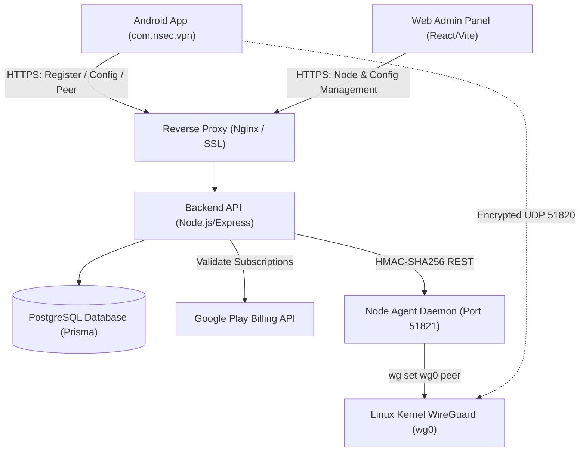

> Repair candidate: see [E2E repair report](docs/E2E-REPAIR-REPORT.md). Production readiness and real-device verification remain pending.

# 🛡️ Nsec VPN — High-Speed WireGuard® Android Client & Management Suite

[](https://developer.android.com)
[](https://www.wireguard.com)
[](https://developer.android.com/jetpack/compose)
[](https://docker.com)
[](https://nsecvpn.com/privacy)

**Nsec VPN** (`com.nsec.vpn`) is a modern, production-grade, zero-logs WireGuard® VPN application designed for Android devices, paired with a web management portal and scalable gateway orchestration backend.

Official Website: **[nsecvpn.com](https://nsecvpn.com)**

---

## 📑 Table of Contents
1. [Key Features & Capabilities](#-key-features--capabilities)
2. [Project Architecture](#-project-architecture)
3. [Quick Start Guides](#-quick-start-guides)
4. [Documentation Library](#-documentation-library)
5. [Google Play Store Release & Policy](#-google-play-store-release--policy)
6. [License & Privacy Guarantee](#-license--privacy-guarantee)

---

## 🚀 Key Features & Capabilities

### 📱 Android Client (`/app`)
- **Modern Pro UI**: High-contrast Material 3 Light/Dark theme with responsive cards, micro-animations, and live stats.
- **WireGuard® Protocol Engine**: Userspace Go backend (`wireguard-android`) using ChaCha20-Poly1305 encryption and Curve25519 key exchanges.
- **Android 14-16 & 16 KB Page Size Compliant**: Fully compliant with Android 14, 15, and 16 (`systemExempted` foreground service type) and 16 KB memory page size alignment for JNI binaries (`useLegacyPackaging = true`).
- **Smart Native Ads Monetization**: Google Native Ads integration (`SmartNativeAd`) with compact, medium, and large layouts, shimmer states, lifecycle caching, and robust null-safety across Home, Server List, and Speed Test screens.
- **AdMob Traffic Split Tunneling Bypass**: Automatic package and domain exclusion rules in `WireGuardTunnelManager` and `NsecVpnService` routing Google Mobile Ads SDK calls outside the VPN tunnel to prevent ad request timeouts or policy flags.
- **Smart Connect**: Automatically checks global node latencies via UDP socket handshakes and connects to the optimal gateway.
- **Custom Encrypted DNS**: One-tap selection between Cloudflare (`1.1.1.1`), Google (`8.8.8.8`), AdGuard (`94.140.14.14`), and Quad9 (`9.9.9.9`).
- **App Split Tunneling**: Exclude banking, local entertainment, or ad SDK apps from the VPN tunnel.
- **Kill Switch Deep-Link**: Native deep-linking into Android system *Always-On VPN* settings.
- **Speedometer & Diagnostics**: Real-time throughput graph, MTU clamping (1420), and DNS leak test verification.
- **Anonymous Authentication**: Random installation IDs with device-held registration proof; Android Keystore protects local encryption. No email addresses, phone numbers, or passwords.
- **Quick Settings Tile**: Toggle VPN directly from Android notification shade.

### 🖥️ Web Admin Panel (`/admin-panel`)
- **Node Management**: Add, modify, or disable WireGuard endpoints, public keys, country flags, and tiers (**FREE** vs. **VIP**).
- **Live Health Monitoring**: Real-time heartbeat queries to edge nodes reporting active peer count and CPU load.
- **Remote Configuration**: Toggle AdMob banners, interstitials, and rewarded ads remotely without app updates.
- **Network Emergency Alerts**: Broadcast announcements directly to the mobile app home screen.
- **Role-Based Access Control**: Server-enforced Super Admin vs Admin permissions with immutable audit trail.

### ⚙️ Gateway Agent & Node Daemon (`/agent`)
- **Zero Shell Injection**: Parameterized `execFile` calls executing kernel `wg set` operations.
- **Reboot Persistence**: `SaveConfig = true` and `wg-quick save` ensure dynamic peer leases survive reboots.
- **Replay-Protected Control**: HMAC-SHA256 signatures with 60-second validity window and deduplication cache.

---

## 🏗️ Project Architecture



---

## ⚡ Quick Start Guides

### 1. Backend API (`/backend`)
```bash
cd backend
npm install
npx prisma generate
npm test
npm run build
npm start
```

### 2. Web Admin Panel (`/admin-panel`)
```bash
cd admin-panel
npm install
npm run build
npm run preview
```

### 3. WireGuard Node Agent (`/agent`)
```bash
cd agent
npm install
npm run build
npm start
```

### 4. 1-Click WireGuard Node Installer (Ubuntu 22.04 / 24.04)
```bash
sudo ./deployment/install-wireguard-node.sh
```

### 5. Android Client (`/app`)
Open the project in Android Studio, sync Gradle, and run `:app` on your Android device or emulator.

---

## 📚 Documentation Library

- [Architecture & Design Details](docs/ARCHITECTURE.md)
- [REST API Specification](docs/API.md)
- [Production Deployment Guide](docs/DEPLOYMENT.md)
- [Administrator Console Guide](docs/ADMIN_GUIDE.md)
- [Google Play Store Release Checklist](docs/PLAY_STORE_CHECKLIST.md)
- [Zero-Logs Privacy Policy Template](docs/PRIVACY_POLICY_TEMPLATE.md)
- [Terms of Service Template](docs/TERMS_TEMPLATE.md)
- [Security & Threat Model](docs/SECURITY.md)
- [Automated & Manual Testing Plan](docs/TESTING.md)
- [Changelog](CHANGELOG.md)
- [Contributing](CONTRIBUTING.md)

---

## 🔒 License & Privacy Guarantee

Nsec VPN is built with strict zero-logs guarantees. WireGuard® is a registered trademark of Jason A. Donenfeld.
Distributed under the Apache 2.0 License.
update

## Admin experience and configuration update

Read [the immutable source audit](docs/EXPERIENCE-AUDIT.md) and [phase 1 setup, migration, API changes and acceptance checklist](docs/EXPERIENCE-PHASE1.md). The redesigned console uses real backend data, day-based promotions, authenticated requests/device lookup and a global ads switch. Retrievable codes require a privately configured `PROMO_CODE_ENCRYPTION_KEY`; existing hashes and exact minute entitlements are retained. Run the additive migration and exact-release schema approval before deploying the new images. Android items and the separate speed-test helper are tracked as subsequent work, not claimed complete by this release.
