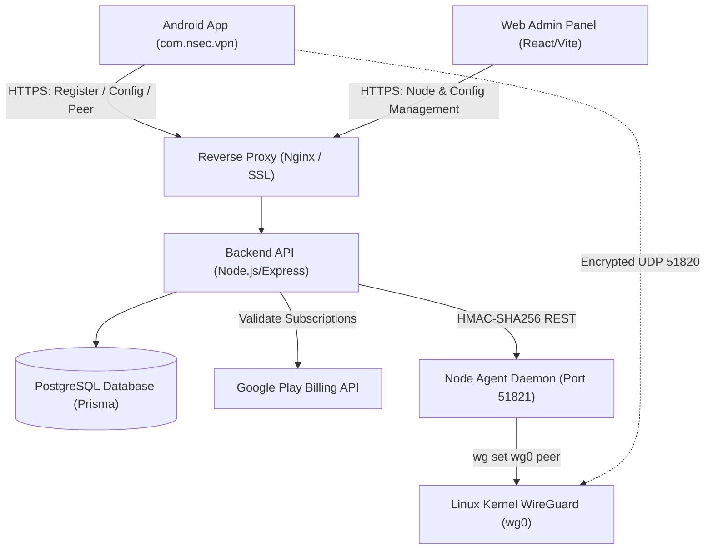
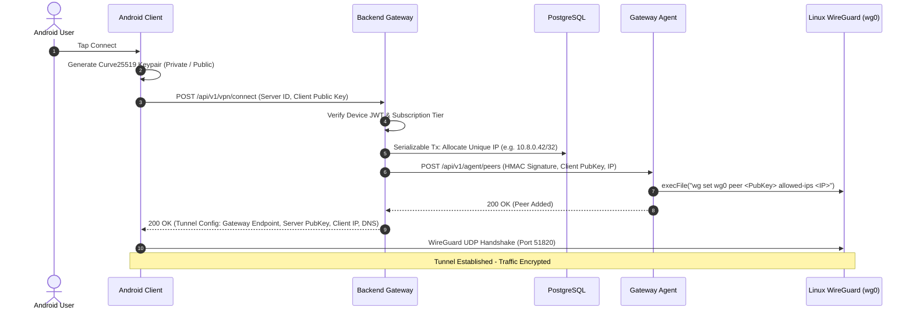
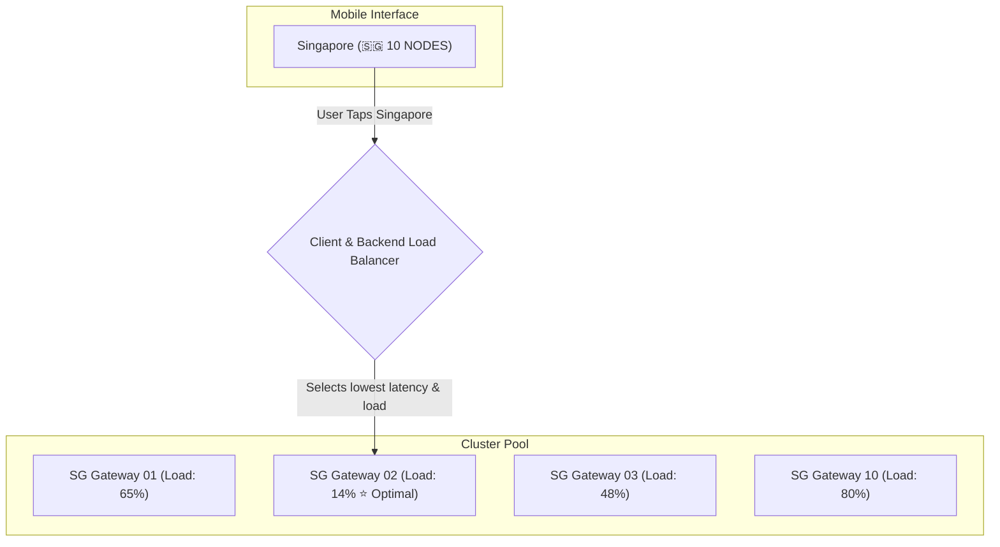

# Nsec VPN Architecture & System Design

This document details the system design, network topologies, cryptographic handshakes, and data models of the **Nsec VPN** platform.

---

## 1. High-Level Architecture

The Nsec VPN ecosystem consists of four interconnected components:
1. **Android Client (`/app`)**: Native WireGuard® Go engine integrated with Jetpack Compose.
2. **Production Backend API (`/backend`)**: Node.js/TypeScript REST API with PostgreSQL and Prisma ORM for device registrations, dynamic peer IP allocations, and configuration.
3. **Web Admin Console (`/admin-panel`)**: React 18 / Tailwind single-page application for infrastructure oversight and remote config toggles.
4. **WireGuard Node Agent (`/agent`)**: Lightweight Linux daemon executing parameterized WireGuard kernel operations on distributed edge servers.

---

## 2. Dynamic WireGuard Peer Handshake Sequence

The client creates a local Curve25519 keypair and requests an encrypted session without exposing private credentials.

---

## 3. Strict No-Logs Architecture

Nsec VPN is engineered with zero-logs guarantees across all tiers:
- **No IP Address Logging**: Client originating IP addresses are never written to disk, database, or log streams.
- **No Traffic Logging**: DNS queries, packet destinations, and throughput contents are never inspected or mirrored.
- **Volatile In-Memory Routing**: WireGuard cryptographic public keys exist only in server volatile RAM for active routing and are purged upon disconnection.
- **Hardware Keystore Authentication**: Authentication relies on client hardware UUIDs stored inside Android Keystore without email addresses or passwords.

---

## 4. Location Cluster Pools & Dynamic Load Balancing

To scale locations horizontally (e.g. 10 servers in Singapore, 20 servers in Frankfurt) without cluttering the mobile application interface, Nsec VPN implements **Two-Layer Location Cluster Load Balancing**:

1. **Client-Side Aggregation (`/app`)**:
   - Multiple servers sharing the same `countryCode` and `city` (e.g. Singapore) are consolidated into a single card in `ServerListScreen`.
   - The card displays the location name ("Singapore"), average cluster load, lowest ping, and a badge indicating the pool size (`10 NODES`).
   - When the user taps Singapore, `VpnRepository.selectServer()` filters all 10 nodes and selects the optimal node minimizing `pingMs + (currentLoad * 2)`.

2. **Server-Side Cluster Routing (`/backend`)**:
   - In `POST /api/v1/vpn/connect`, if the requested server is part of a multi-node cluster, the backend verifies all sister nodes in that location and automatically routes the handshake to the least-loaded active gateway.
   - If a specific gateway reaches capacity or goes offline, the cluster automatically reroutes handshakes to the next available sister gateway in that same city.
update
